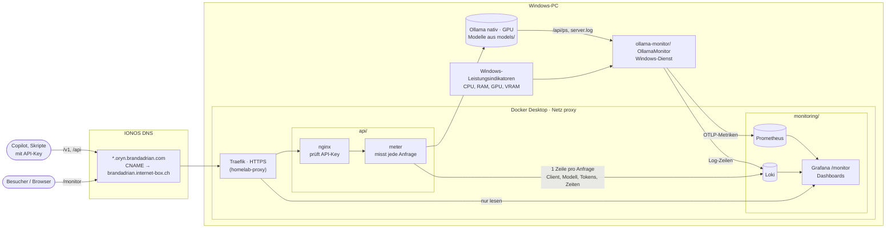

# Oryn AI Portal

Eigene LLMs von aussen nutzen: **API mit Key**, **eigene Modelle** und **Monitoring** an einem Ort.
Läuft auf einem Windows-PC mit Ollama (nativ, GPU) und Docker Desktop, erreichbar über Traefik aus dem
[homelab-proxy](https://github.com/brandadrian/homelab-proxy).

| Adresse | Was |
|---------|-----|
| `https://api.oryn.brandadrian.com/v1` | OpenAI-kompatible API (Copilot, SDKs), Bearer-Key nötig |
| `https://api.oryn.brandadrian.com/api` | Ollama-API, Bearer-Key nötig |
| `https://monitoring.oryn.brandadrian.com/monitor` | Grafana, öffentlich nur lesen (`/` leitet hierhin) |
| `https://chat.oryn.brandadrian.com` | Open WebUI (`openwebui/`) |
| `http://localhost:3000/monitor` | Grafana lokal mit Admin-Login |

Alte Adressen laufen vorerst parallel: `ollama.homelab.brandadrian.com` (API), `ollama-monitoring.homelab.brandadrian.com` (leitet auf `/monitor`).

## Inhalt

- [System-Kontext](#system-kontext)
- [Struktur](#struktur)
- [Einrichten](#einrichten)
- [Dokumentation](#dokumentation)

## System-Kontext



- **Dashboard "Ollama & Rechner":** Hardware, Auslastung, geladene Modelle, Tokens aller Clients (aus `server.log`, also auch Open WebUI und Saba).
- **Dashboard "Ollama API (Anfragen)":** nur Anfragen über diese API, dafür pro Anfrage mit Client, Modell, Cache und Zeiten.

## Struktur

```
api/             nginx (API-Key-Prüfung) + meter (Mess-Proxy, Node)        → docs/api.md
models/          Modelfiles der eigenen Modelle                            → docs/models.md
monitoring/      Prometheus, Loki, Grafana (Dashboards, Daten in data/)    → docs/monitoring.md
ollama-monitor/  OllamaMonitor (.NET 10, ollama-monitor.slnx): Windows-Dienst für Hardware + Ollama-Metriken,
                 Dockerfile für den optionalen Container (ohne Hardware-Werte)
openwebui/       Open WebUI: Chat und Modellverwaltung mit Login             → docs/openwebui.md
docs/            Detail-Dokumentation
```

## Einrichten

Voraussetzungen: Ollama nativ unter Windows, Docker Desktop, laufender [homelab-proxy](https://github.com/brandadrian/homelab-proxy)
(Traefik und Docker-Netz `proxy`), IONOS-CNAME `*.oryn` → `brandadrian.internet-box.ch`.

1. **Modelle** anlegen → [docs/models.md](docs/models.md)
2. **Monitoring** starten (zuerst, die API schreibt nach Loki):

   ```bash
   cd monitoring && docker compose up -d
   ```

3. **API** starten: `api/.env` aus `api/.env.example` erstellen, Key setzen (PowerShell: `[guid]::NewGuid()`), dann

   ```bash
   cd api && docker compose up -d
   ```

4. **OllamaMonitor als Windows-Dienst** → [docs/monitoring.md](docs/monitoring.md#ollamamonitor-als-windows-dienst)
5. **Open WebUI** starten: `openwebui/.env` aus `openwebui/.env.example`, dann `cd openwebui && docker compose up -d` → [docs/openwebui.md](docs/openwebui.md)

Nach dem ersten `docker compose up` prüfen, ob die Container in beiden Netzen hängen (`docker inspect <name>`).
Docker Desktop hängt beim ersten Start manchmal nur ein Netz an, dann `docker compose up -d --force-recreate`.

## Dokumentation

| Thema | Datei |
|-------|-------|
| API: Zugang, Endpunkte, Clients, Anfragen auswerten und optimieren | [docs/api.md](docs/api.md) |
| Modelle: welche, wofür, Benchmarks, GPU-Planung | [docs/models.md](docs/models.md) |
| Monitoring: Dashboards, OllamaMonitor-Dienst, öffentliches Grafana | [docs/monitoring.md](docs/monitoring.md) |
| Open WebUI: Chat, Modelle verwalten, Benutzer | [docs/openwebui.md](docs/openwebui.md) |
