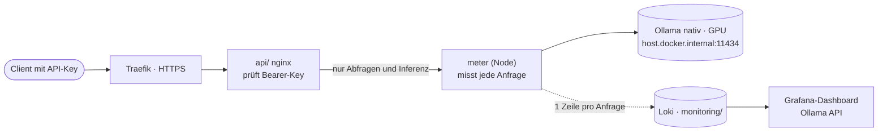

# LLM-API

[← zurück zur README](../README.md)

Direkter Zugriff auf die lokalen Modelle (z.B. aus VS Code, Skripten, anderen Apps), abgesichert mit einem API-Key (GUID). Ollama selbst hat keine Auth, deshalb steht nginx davor und prüft den Key.

- Öffentlich: https://api.oryn.brandadrian.com (`/v1` und `/api`)
- Lokal: https://ollama.localhost



## Dateien

```
api/docker-compose.yml                nginx + meter + Traefik-Labels
api/templates/default.conf.template   Key-Prüfung und erlaubte Endpunkte
api/meter/server.mjs                  Mess-Proxy (Node 22, ohne Abhängigkeiten)
api/.env.example                      Vorlage für den Key
api/.env                              der echte Key (nicht im Git)
```

## Starten

Im Ordner `api/`: `.env` aus `.env.example` erstellen, Key setzen (PowerShell: `[guid]::NewGuid()`), dann:

```bash
docker compose up -d
```

Key ändern: `.env` anpassen, dann `docker compose up -d --force-recreate`.

## Benutzen

Header `Authorization: Bearer <Key>` mitschicken.

```bash
curl https://api.oryn.brandadrian.com/api/tags -H "Authorization: Bearer <Key>"

curl https://api.oryn.brandadrian.com/api/chat -H "Authorization: Bearer <Key>" \
  -d '{"model":"gpt-oss:20b","messages":[{"role":"user","content":"Hallo"}]}'
```

PowerShell (`curl` ist dort ein Alias für `Invoke-WebRequest`, deshalb `curl.exe` oder):

```powershell
Invoke-RestMethod https://api.oryn.brandadrian.com/api/tags -Headers @{ Authorization = "Bearer <Key>" }
```

OpenAI-kompatible Clients: Base-URL `https://api.oryn.brandadrian.com/v1`, API-Key = der Key.

GitHub Copilot (VS Code): Chat: Manage Language Models → OpenAI Compatible → Base-URL `https://api.oryn.brandadrian.com/v1`, API-Key, Modell-ID (z.B. `qwen3.8:27b-agent`).

## Modelle

Welche Modelle es gibt und wofür: [models.md](models.md). Liste per API: `GET /v1/models` oder `GET /api/tags`.

Die `ollama`-CLI (`OLLAMA_HOST=...`) kann keinen Header mitschicken und funktioniert deshalb nicht von aussen.

## Erlaubte Endpunkte

| Ollama | OpenAI-kompatibel |
|--------|-------------------|
| `/api/chat`, `/api/generate`, `/api/embed`, `/api/embeddings` | `/v1/chat/completions`, `/v1/completions`, `/v1/embeddings` |
| `/api/tags`, `/api/show`, `/api/ps`, `/api/version` | `/v1/models` |

`/api/models`, `/api/chat/completions` und `/api/completions` werden auf `/v1/...` umgeleitet, weil GitHub Copilot diese Pfade aufruft.

Gesperrt (404): `pull`, `push`, `create`, `copy`, `delete`, `blobs`. Modelle verwalten nur lokal (siehe [models.md](models.md)) oder über Open WebUI.

## Anfragen auswerten

Zwischen nginx und Ollama sitzt der Mess-Proxy `meter`. Er reicht alles unverändert durch und schreibt pro Inferenz-Anfrage
(`/api/chat`, `/api/generate`, `/api/embed`, `/v1/chat/completions`, `/v1/completions`, `/v1/embeddings`) eine JSON-Zeile nach Loki
(`job="ollama-api"`, Labels `client`, `model`, `endpoint`). Prompt-Inhalte werden nicht gespeichert.

Dashboard: **Ollama API (Anfragen)** in Grafana, https://monitoring.oryn.brandadrian.com/monitor (lokal http://localhost:3000/monitor).
Loki/Grafana laufen in `monitoring/`, siehe [monitoring.md](monitoring.md). Ist Loki nicht erreichbar, läuft die API trotzdem weiter.

| Feld | Bedeutung |
|------|-----------|
| `client` | aus dem User-Agent: `copilot`, `open-webui`, `curl`, `python`, `powershell`, `openai-sdk`, `node`, `andere` |
| `prompt_tokens`, `cached_tokens`, `cache_pct` | Kontext-Tokens, davon aus Ollamas Cache wiederverwendet |
| `output_tokens`, `output_tps` | generierte Tokens, Geschwindigkeit |
| `wait_ms` | Wartezeit (Warteschlange, Modell laden): Dauer minus Rechenzeit |
| `prompt_ms`, `output_ms`, `duration_ms` | Kontext einlesen, Antwort generieren, Gesamtdauer |
| `messages`, `tools` | Anzahl Nachrichten und Tool-Definitionen im Request |
| `status`, `done_reason`, `aborted` | HTTP-Status, Ende (`stop`, `length`, `tool_calls`), vom Client abgebrochen |

Bei gestreamten OpenAI-Anfragen setzt der Proxy `stream_options.include_usage`, damit Ollama die Token-Zahlen mitschickt
(zusätzlicher letzter Chunk nach OpenAI-Standard).

**Was optimieren?**

- **Cache % niedrig, Prompt ms hoch:** Der Client schickt den Kontext jedes Mal verändert. Ollama kann nur einen gleichen Anfang wiederverwenden. Weniger wechselnde Dateien/Tools im Kontext, stabiler System-Prompt.
- **Prompt-Tokens nahe am Kontext oder `done_reason=length`:** `num_ctx` reicht nicht, Antwort wird abgeschnitten.
- **Warten ms hoch:** Anfragen stehen Schlange (Ollama rechnet eine nach der anderen) oder das Modell wird neu geladen. Modellwechsel vermeiden, `OLLAMA_MAX_LOADED_MODELS=2`.
- **Tok/s niedrig:** Modell liegt teilweise auf der CPU (`ollama ps`), kleineres Modell oder weniger Kontext.
- **Viele Tools:** Jede Tool-Definition kostet Kontext. In Copilot nur nötige MCP-Server/Tools aktivieren.

Logs des Proxys (im Ordner `api/`): `docker compose logs -f meter` (eine Zeile pro Anfrage).

## Routing (Traefik)

Jeder Teil hat eine eigene Subdomain: `api.oryn.brandadrian.com` (API), `monitoring.oryn.brandadrian.com` (Grafana, `/` leitet auf `/monitor`), `chat.oryn.brandadrian.com` (Open WebUI, oryn-gateway).
Grafanas eigene API liegt unter `/monitor/api` und kollidiert deshalb nicht.

## Sicherheit

- Ohne gültigen Key: `401`.
- Nur über HTTPS erreichbar (Traefik leitet HTTP auf HTTPS um).
- Der Key wird nicht an Ollama weitergegeben.
- Key nie ins Repo schreiben. Bei Verdacht neuen Key erzeugen.
