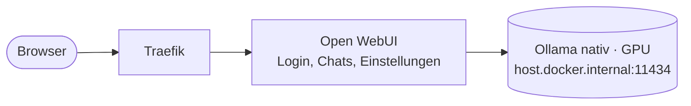

# Open WebUI – Chat und Modellverwaltung mit Login

[← zurück zur README](../README.md)

Chat-Oberfläche für die lokalen Modelle, inklusive Modelle anzeigen, installieren und löschen. Die Modelle laufen in Ollama nativ unter Windows ([Modelle](models.md)).

- Öffentlich: https://chat.oryn.brandadrian.com (alt, läuft parallel: https://openwebui.homelab.brandadrian.com)
- Lokal: https://openwebui.localhost



## Dateien

```
openwebui/docker-compose.yml   Open WebUI + Traefik-Labels (Projektname openwebui)
openwebui/.env.example         Vorlage für die Secrets
openwebui/.env                 Admin-Login und Session-Key (nicht im Git)
```

Benutzer, Chats und Einstellungen liegen im Docker-Volume `openwebui_data`.

## Starten

`.env` aus `.env.example` erstellen und ausfüllen, dann:

```bash
docker compose up -d
```

Der Admin wird beim ersten Start aus der `.env` angelegt. So gibt es keinen Moment, in dem sich ein Fremder als erster Benutzer registrieren und Admin werden könnte.

## Modelle verwalten

Als Admin unter Admin-Einstellungen → Modelle:

- **Anzeigen:** Liste aller Modelle in Ollama.
- **Installieren / Löschen:** Das wirkt direkt auf Ollama, also auch auf Saba. Das Modell `saba` nicht löschen.
- **Beschreibung:** Modell bearbeiten → Feld "Beschreibung", z.B. wofür es nützlich ist. Sie liegt nur in Open WebUI und erscheint in der Modellauswahl.

Nach dem Löschen kann das Modell noch kurz in der Liste stehen, weil Open WebUI die Liste zwischenspeichert.

### Beschreibungen

Zum Einfügen ins Feld "Beschreibung":

| Modell | Beschreibung |
|--------|--------------|
| `qwen3.8:27b-agent` | Für Agenten und Tool-Calls (z.B. Copilot): stabil, 128k Kontext, läuft komplett auf der GPU. |
| `qwen3.8:27b` | Das klügste Modell: Analysen und Code, läuft komplett auf der GPU. |
| `gpt-oss:20b` | Sehr schnell, für Chat und schwierige Fragen mit längerem Nachdenken, ohne Bilder. |
| `qwen3.5:9b` | Schneller Allrounder mit Denkmodus, versteht auch Bilder. |
| `qwen3-vl:8b-instruct` | Für Bilder und Rechnungen: Inhalte direkt auslesen, ohne Denkmodus. |
| `saba:latest` | Eigener Chat-Bot Saba mit eigenem Sprachstil, locker und witzig. |
| `gemma3:27b` | Basis für Saba. Gutes Deutsch, kreativ, versteht auch Bilder. |

## Update

Version in `docker-compose.yml` anpassen (bewusst fest, weil Updates die Datenbank migrieren), dann `docker compose up -d`. Vorher das Volume sichern.

## Sicherheit

- Login ist Pflicht, Selbstregistrierung ist aus (`ENABLE_SIGNUP=false`). Neue Benutzer legt der Admin an.
- Installieren und Löschen von Modellen geht nur als Admin.
- Die Login-Seite ist öffentlich, deshalb ein langes Passwort verwenden.
- Einstellungen wie `ENABLE_SIGNUP` speichert Open WebUI nach dem ersten Start in der Datenbank. Ab dann gilt, was in den Admin-Einstellungen steht.
- Ollama selbst ist von aussen nur über Open WebUI und die [LLM-API mit Key](https://github.com/brandadrian/oryn-ai-portal) (Repo oryn-ai-portal) erreichbar.
