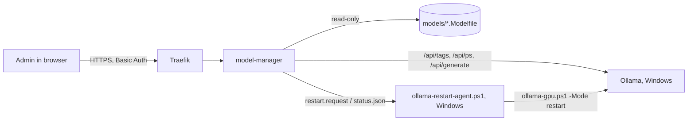

# Model Manager – Documentation

Purpose: switch the model Ollama keeps in VRAM from a browser, without a shell on the PC.

- [Software requirements specification](software-requirements-specification.md)
